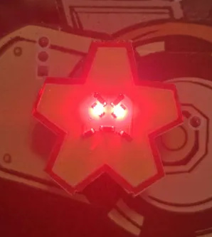

# Do you Want to Build a ~~Snowman~~ Blinky Badge?
mlp @ [615 Labs](615-labs.com)

PhreakNIC 27

CC BY-NC-SA 4.0[^1]
---
# who is this weirdo?
- from the Land of the Drop Bear
- started playing with electronics in 1982
- etched simple circuit boards
- got an EE degree
- got a job fixing the software side of PCs
- moved Over Here in 2016
- went to DEF CON in 2017, found his people
- designed a badge and got hooked again

# what is "615 Labs"
- several weirdos
- different backgrounds
- shared desire to brain-dump
- a website to save our voices
- pick our brains at cons
- buy our blinkies to help us do more

---
# why are we here today?
Do you have an idea for illuminated wearable bling but you're not sure how to translate the idea into physical reality?
Even if you've never lifted a soldering iron in anger; couldn't identify a surface mount resistor if you stood on one; or wouldn't know a schematic diagram from a datasheet; resources, tools, and services are available to help you make your own Thing without paying extortionate moneys. You can also (for now) remain free of AI slop if you wish.

During this session we will walk through the necessary steps to design and build (or, have someone build for you) a Blinky Badge, including
- form factors (badge vs SAO)
- PCB art constraints (limited layers vs full-color)
- simple sample circuits
- types of component (what they do, what they look like, what their limitations are)
- how to plagiarize^W embrace-and-extend existing designs
- software tools (local vs online)
- suppliers
- just how much $ does it cost?

---
# form factors (badge vs SAO)
badge: self-contained, including power source and mounting (lanyard/pin)

SAO: plugs in to a badge to get power and support, and/or add functionality

---
# PCB art constraints (limited layers vs full-color)
broke: presence-or-absence of copper, soldermask, silkscreen on one or both sides, plus front- and back-lighting

(for example, Keanu above)

woke: full-color UV-cured ink printing

---
# simple sample circuits
glow: optional switch, current-limiting resistor, LED

blink: 555 timer, timing components, brightness components, LED(s)

<video><source src="https://github.com/eutectic6337/PN27-Snowman/raw/refs/heads/main/i/workshop-blinker.mp4"></video>

programmable: microcontroller+support, LED(s), firmware

<video><source src="https://github.com/eutectic6337/PN27-Snowman/raw/refs/heads/main/i/flask-sao.mp4"></video>

---
# types of component (what they do, what they look like, what their limitations are)
through-hole

surface-mount

LED

resistor

capacitor

integrated circuit

---
# how to ~~plagiarize~~ embrace-and-extend existing designs
github, Hackaday, etc.
- just build somebody else's design
- use existing schematic, tweak the board
- use existing schematic, roll your own board
- tweak schematic, tweak-or-respin board

---
# software tools (local vs online)
KiCad

EasyEDA

---
# suppliers
[AliExpress](aliexpress.com)

[JLCPCB](jlcpcb.com)

[LCSC](lcsc.com)

[OSHpark](oshpark.com)

[DigiKey](digikey.com)

[Macrofab](macrofab.com/platform)

[SVTronics](svtronics.com)

[ExPlus](explus.com.tw/products.htm)

[UtiMachine](ultimachine.com/pages/electronics-manufacturing-services)

---
# just how much $ does it cost?
Actual case studies:
- TN badge: 60 of, hand assembled $30 ea
- challenge coin: 200 of, somewhat machine assembled $2 ea
- flask SAO: 200 of, almost all machine assembled $0.90 ea

---
https://github.com/eutectic6337/PN27-Snowman

[^1]: This project is licensed under the terms of the
[Creative Commons Attribution-NonCommercial-ShareAlike 4.0 International](https://creativecommons.org/licenses/by-nc-sa/4.0/)
license.
