# Do you Want to Build a ~~Snowman~~ Blinky Badge?
mlp @ [615 Labs](615-labs.com)

PhreakNIC 27

CC BY-NC-SA 4.0[^1]
---
# who is this weirdo?
- from the Land of the Drop Bear
- started playing with electronics in 1982
- etched simple circuit boards
- got an EE degree
- got a job fixing the software side of PCs
- moved Over Here in 2016
- went to DEF CON in 2017, found his people
- designed a badge and got hooked again

# what is "615 Labs"
- several weirdos
- different backgrounds
- shared desire to brain-dump
- a website to save our voices
- pick our brains at cons
- buy our blinkies to help us do more

---
# why are we here today?
Do you have an idea for illuminated wearable bling but you're not sure how to translate the idea into physical reality?
Even if you've never lifted a soldering iron in anger; couldn't identify a surface mount resistor if you stood on one; or wouldn't know a schematic diagram from a datasheet; resources, tools, and services are available to help you make your own Thing without paying extortionate moneys. You can also (for now) remain free of AI slop if you wish.

During this session we will walk through the necessary steps to design and build (or, have someone build for you) a Blinky Badge, including
- form factors (badge vs SAO)
- PCB art constraints (limited layers vs full-color)
- simple sample circuits
- types of component (what they do, what they look like, what their limitations are)
- how to plagiarize^W embrace-and-extend existing designs
- software tools (local vs online)
- suppliers
- just how much $ does it cost?

---
# form factors (badge vs SAO)
badge: self-contained, including power source and mounting (lanyard/pin)

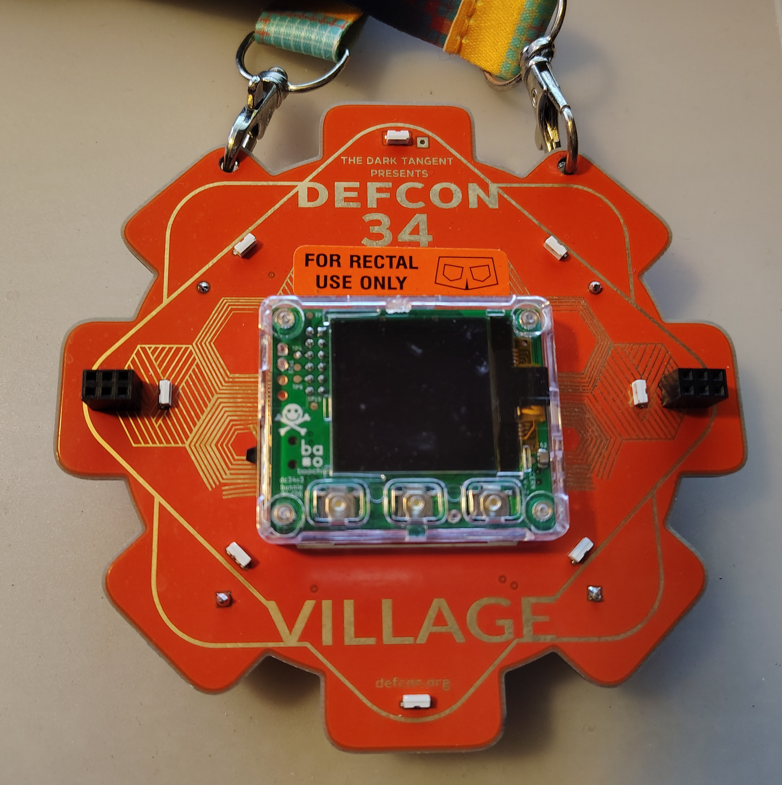
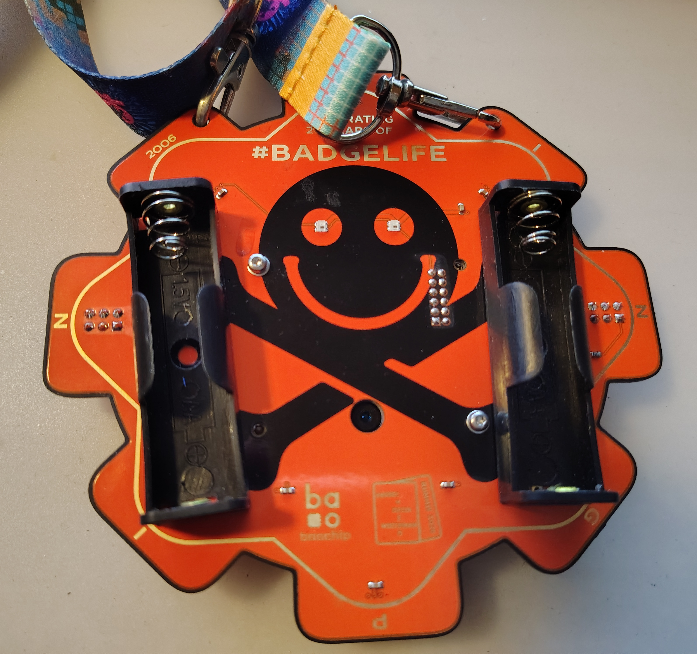

SAO: plugs in to a badge to get power and support, and/or add functionality

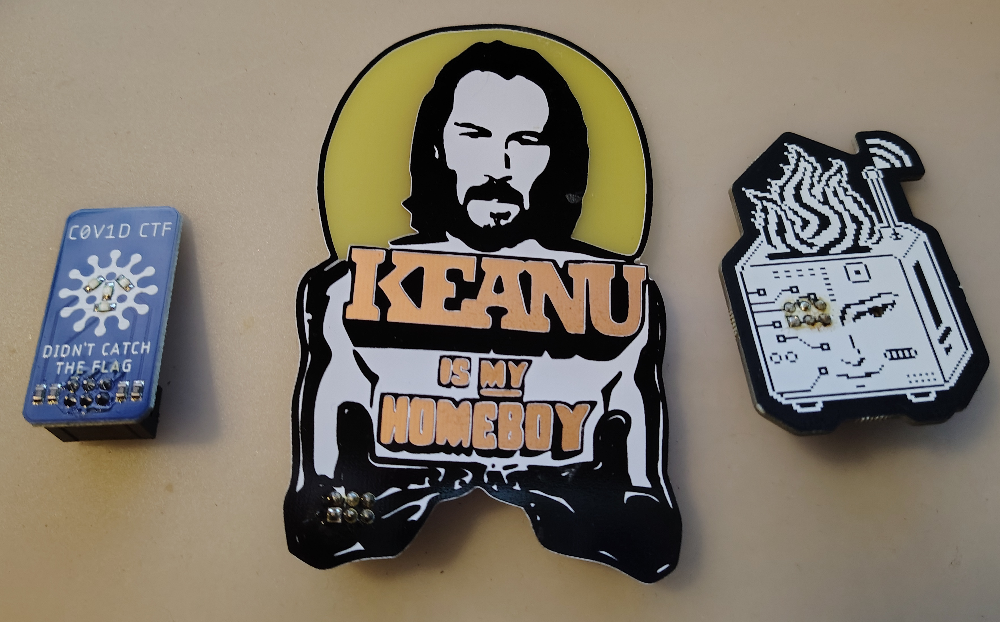
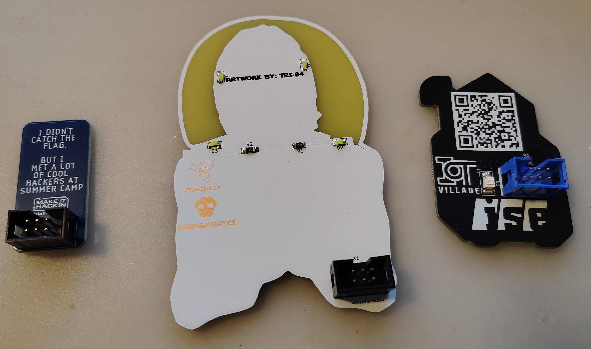

---
# PCB art constraints (limited layers vs full-color)
broke: presence-or-absence of copper, soldermask, silkscreen on one or both sides, plus front- and back-lighting

(for example, Keanu above)

woke: full-color UV-cured ink printing

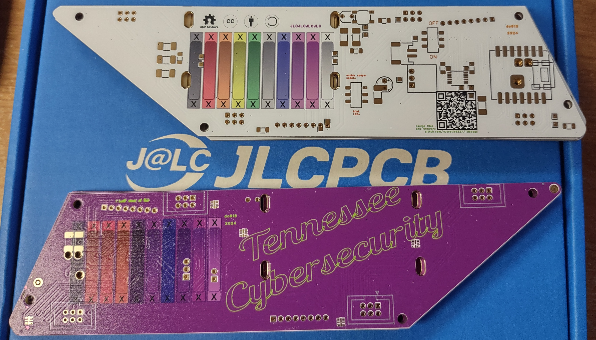

---
# simple sample circuits
glow: optional switch, current-limiting resistor, LED

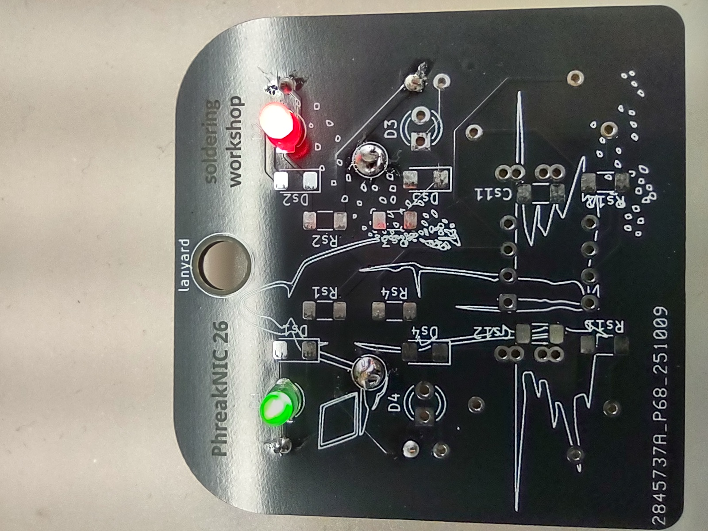

blink: 555 timer, timing components, brightness components, LED(s)

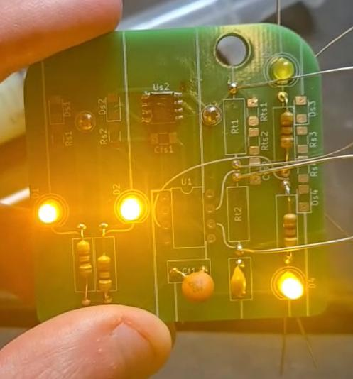
<video><source src="https://mlp.sarce.net/workshop-blinker.mp4"></video>

programmable: microcontroller+support, LED(s), firmware

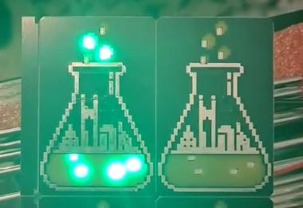
<video><source src="https://mlp.sarce.net/flask-sao.mp4"></video>

---
# types of component (what they do, what they look like, what their limitations are)

## [through-hole (THT)](https://en.wikipedia.org/wiki/Through-hole_technology)

- electrical contacts are wires that go *through* holes in circuit board
- larger, easier for eyes to see and fingers to manipulate
- 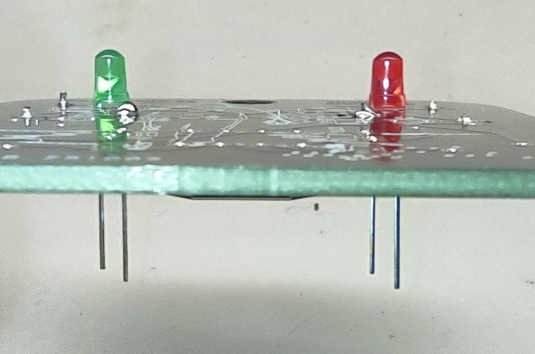
- 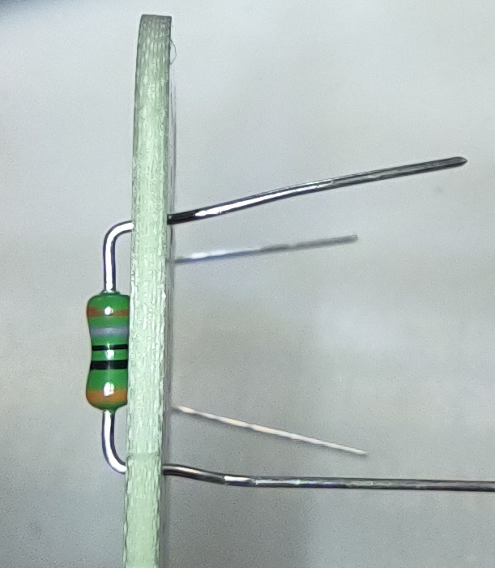

## [surface-mount (SMT)](https://en.wikipedia.org/wiki/Surface-mount_technology)

- electrical contacts are flat metal pads that sit against surface of circuit board
- smaller, more difficult for humans but easier for machines

## Light Emitting Diode (LED)

- convert electric current into light
- 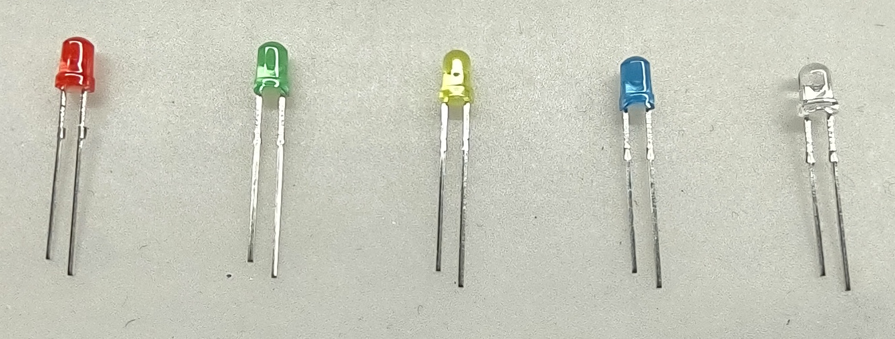
- 
- connect wrong way: no go
- too much juice: becomes Smoke Emitting Diode, then Dark Emitting Diode

## resistor

- convert electric current into heat and potential-drop (Ohm's Law)
- 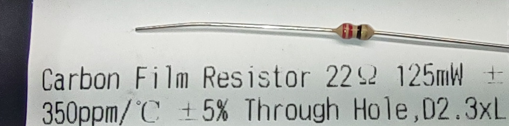
- 
By 01x07x2022000 - Own work, CC0, https://commons.wikimedia.org/w/index.php?curid=121209738
- too much juice: will emit light and smoke, once

## capacitor

- store and release electric charge
-  PCBWay
-  EBest Circuit

## integrated circuit "chip"

- combines many functions into one package, thus "integrated"
- 
By [Kimmo Palosaari](http://openphoto.net/user/profile.html?id=5757) - [OpenPhoto.net](http://openphoto.net/gallery/image.html?image_id=9673),
Public Domain, [Link](https://commons.wikimedia.org/w/index.php?curid=670348)
- 
By I, NobbiP, CC BY-SA 3.0, [Link](https://commons.wikimedia.org/w/index.php?curid=1148101)
- same limitations as LED only more so
- e.g. microcontroller can have arbitrarily-complex behaviour

---
# how to ~~plagiarize~~ embrace-and-extend existing designs
github, Hackaday, etc.
- just build Somebody Else's Design
  - minimal effort option
  - constrained by Somebody Else's Idea, circuit, board, and your own assembly skills 
- use existing schematic, tweak the board
  - e.g. change the silkscreen/art and maybe relocate some LEDs
  - don't need to understand the circuit much at all
  - a gentle introduction to PCB CAD program
- use existing schematic, roll your own board
  - a blank slate for the PCB, but keep the same circuit function
  - probably don't need to understand the circuit in depth
- tweak schematic, tweak-or-respin board
  - e.g. duplicate part of the design (double the blinking LEDs, for instance)
  - might still get away with minimal circuit knowledge
  - it's actually how we made the [flask SAO](#flask-SAO) starting from our [challenge coin](https://github.com/eutectic6337/coin1)
  by replacing the battery connection with a 6-pin SAO connector, and dropping the second 8 LEDs
  (and, simplifying the final assembly enormously)

---
# software tools (local vs online, commercial vs free)
- Altium
  - commercial tool - much bucks
  - used to be Protel

- Eagle
  - free-as-in-beer tool
  - came under AutoDesk's umbrella years ago
  - now End-of-Life

- KiCad
  - open-source app very similar in operation to Protel Schematic/AutoTrax from 35 years ago
  - runs entirely local
  - has many plugins available, and a Python scripting interface

- EasyEDA
  - online tool by Chinese PCB manufacturer JLCPCB (and has a local/desktop version)
  - very similar in operation to KiCad
  - only way to use JLCPCB's full-color printing-on-PCB service
  - powerful import/export facility allows interoperation with other tools (e.g. KiCad, Altium)

---
# suppliers
[AliExpress](aliexpress.com)

[JLCPCB](jlcpcb.com)

[LCSC](lcsc.com)

[OSHpark](oshpark.com)

[DigiKey](digikey.com)

[Macrofab](macrofab.com/platform)

[SVTronics](svtronics.com)

[ExPlus](explus.com.tw/products.htm)

[UtiMachine](ultimachine.com/pages/electronics-manufacturing-services)

---
# just how much $ does it cost?
Actual case studies:
- [TN badge](https://github.com/eutectic6337/TNbadge): 60 of, hand assembled $30 ea
- [challenge coin](https://github.com/eutectic6337/coin1): 200 of, somewhat machine assembled $2 ea
- [flask SAO](https://github.com/eutectic6337/615-labs-SAO): 200 of, almost all machine assembled $0.90 ea

---
https://github.com/eutectic6337/PN27-Snowman

[^1]: This project is licensed under the terms of the
[Creative Commons Attribution-NonCommercial-ShareAlike 4.0 International](https://creativecommons.org/licenses/by-nc-sa/4.0/)
license.
